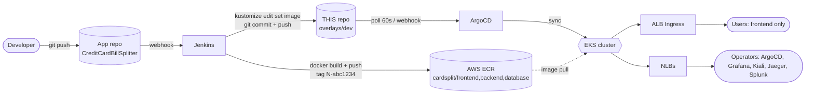

# cardsplit-gitops

GitOps repository that deploys **CardSplit** (React/Nginx frontend · Node/Express backend · PostgreSQL) to
**Amazon EKS 1.36** with **ArgoCD**, fed by a **Jenkins → AWS ECR** CI pipeline, and wrapped in a full
platform stack: Istio, Prometheus/Grafana, Kiali, Jaeger, Fluent Bit → Splunk, autoscaling and RBAC.

> The application source lives in a separate repo (`CreditCardBillSplitter`). This repo contains **only
> deployment configuration** - the Jenkins job in the app repo edits the image tags here, ArgoCD does the rest.

## How it flows



## Runtime architecture

```
Internet ── ALB (Ingress) ──► frontend (nginx, 2-6 pods, HPA) ──► backend (Express, 2-6 pods, HPA) ──► database (PostgreSQL StatefulSet + EBS gp3 PVC)
                                   │  Istio sidecars: mTLS STRICT (backend, db), AuthorizationPolicy, retries/timeouts, tracing
Internet ── NLB ──► ArgoCD · Grafana · Kiali · Jaeger UI · Splunk Web
Fluent Bit (DaemonSet) ─► Splunk HEC        Envoy/istiod/postgres metrics ─► Prometheus ─► Grafana, Alertmanager, Kiali
Node groups:  ng-app (workload=app) · ng-data (workload=data, TAINT dedicated=data) · ng-platform (workload=platform)
```

## Repository layout

```
cardsplit-gitops/
├── apps/cardsplit/
│   ├── base/                     # environment-neutral manifests (Kustomize)
│   │   ├── frontend.yaml backend.yaml database.yaml     # Deployments / StatefulSet + Services
│   │   ├── hpa.yaml pdb.yaml ingress.yaml istio.yaml
│   │   ├── limitrange-quota.yaml rbac.yaml serviceaccounts.yaml
│   │   └── nginx.conf.template   # K8s-specific nginx config (ConfigMap generator)
│   └── overlays/{dev,prod}/      # namespace, image tags (Jenkins edits these), sizing, secrets, authz policies
├── platform/                     # cluster add-ons
│   ├── base/                     # namespaces, StorageClasses, cluster RBAC, platform secrets
│   ├── istio/ (values + mesh config)   monitoring/ (values, Istio monitors, alerts, dashboard)
│   ├── logging/ (Fluent Bit)  splunk/  jaeger/  kiali/
│   └── autoscaling/ (metrics-server, cluster-autoscaler)  ingress/ (AWS LB Controller)  sealed-secrets/
├── argocd/
│   ├── projects/                 # AppProjects (platform, cardsplit) with RBAC
│   └── apps/                     # one Application per component, ordered with sync-waves
├── bootstrap/                    # argocd-values.yaml, root-app.yaml (app-of-apps), repo credentials example
├── clusters/eks-prod/            # eksctl cluster config + IAM policy for Jenkins
├── ci/                           # app-repo/Jenkinsfile  (copy to the app repo)  ·  gitops-repo/Jenkinsfile.promote
├── scripts/                      # configure, create-ecr-repos, seal-secrets, validate, pin-chart-versions
└── docs/                         # step-by-step guide (start with 01)
```

## Where each requirement is implemented

| # | Requirement | Where |
|---|---|---|
| 1 | StorageClass, PVC | `platform/base/storageclass.yaml` (gp3-delete default, gp3-retain) · PVCs from `volumeClaimTemplates` in `apps/cardsplit/base/database.yaml`, Prometheus/Grafana/Splunk values |
| 2 | HPA, "HNA" (node autoscaling) | `apps/cardsplit/base/hpa.yaml` · `platform/autoscaling/cluster-autoscaler-values.yaml` |
| 3 | ConfigMap, Secrets | `configMapGenerator` in `apps/cardsplit/base/kustomization.yaml` · `overlays/*/secret.yaml` + `scripts/seal-secrets.sh` (Sealed Secrets) |
| 4 | Requests & limits | every container; `limitrange-quota.yaml` adds namespace defaults + quota |
| 5 | RBAC | `apps/cardsplit/base/rbac.yaml`, `platform/base/rbac/`, `bootstrap/argocd-values.yaml` (ArgoCD RBAC), `argocd/projects/` |
| 6 | Fluent Bit | `platform/logging/fluent-bit-values.yaml` |
| 7 | Splunk | `platform/splunk/splunk.yaml` |
| 8 | ArgoCD | `bootstrap/`, `argocd/` (app-of-apps, projects, sync waves, auto-sync) |
| 9 | Prometheus & Grafana | `platform/monitoring/` |
| 10 | Kiali | `platform/kiali/values.yaml` (+ Istio in `platform/istio/`) |
| 11 | Deployment strategy | RollingUpdate `maxUnavailable: 0` (Deployments), StatefulSet RollingUpdate, PDBs, `minReadySeconds`, preStop drain |
| 12 | Internet exposure via LB | ALB Ingress (frontend) · NLB `type: LoadBalancer` for ArgoCD, Grafana, Kiali, Jaeger, Splunk |
| 13 | Frontend via Ingress LB | `apps/cardsplit/base/ingress.yaml` (AWS Load Balancer Controller) |
| 14 | Pod affinity / anti-affinity | `backend.yaml`, `frontend.yaml`, `database.yaml` (affinity blocks) |
| 15 | Node affinity / node anti-affinity | backend `In [app]` · frontend `NotIn [data, platform]` · database `In [data]` |
| 16 | Taints & tolerations | `ng-data` taint in `eksctl-cluster.yaml` · toleration in `database.yaml`, Fluent Bit, node-exporter |
| 17 | Probes | startup + readiness + liveness on frontend, backend, database, exporter, Splunk, Jaeger |
| 18 | Jaeger | `platform/jaeger/jaeger.yaml` + Istio `Telemetry` in `platform/istio/config/` |

## Start here

1. Read `docs/01-prerequisites.md`, then follow the chapters **in order** (01 → 08).
2. Every step lists the command and the **expected output**.

Design notes and honest limits are in `docs/08-operations-and-troubleshooting.md`.
